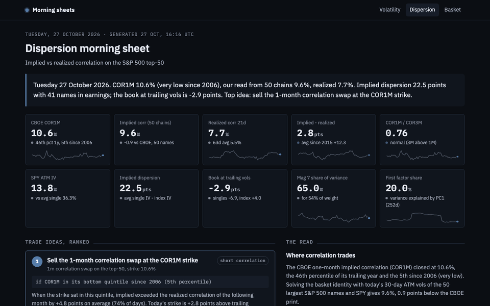

# Equity Dispersion: implied vs realized correlation on the S&P 500

**Live morning sheet: [https://morning-sheet-nine.vercel.app/dispersion](https://morning-sheet-nine.vercel.app/dispersion)**, regenerated every weekday after the US close.



Streamlit app that rebuilds the CBOE implied correlation index from live option chains,
compares it with the realized correlation of the basket since 2006, and backtests the
correlation leg of a dispersion trade. Free data only, so anyone can rerun it.

Companion to the [volatility dashboard](../vol_dashboard): same option-pricing code
(Black-76 on the put-call-parity forward), applied to 50 single names at once.

## Three results worth defending

**1. Implied correlation rebuilt from 50 option chains lands within 0.6 point of the CBOE print.**
On 2026-10-27, solving the basket identity with the 30-day ATM implied vols of the 50 largest
S&P 500 names and of SPY gives 10.0% implied correlation; the CBOE COR1M closed at 10.6%.
Same method as the CBOE (top 50, re-weighted), same answer.

**2. Implied correlation sits above realized almost every month, and the premium collapsed in 2024.**
Since 2015 the one-month implied correlation (COR1M) averaged well above the realized
correlation of the basket over the following month. Index options are bought as portfolio
insurance and single-name options are sold by overwriters, so the spread between index vol
and its parts carries a premium. From 2024 the premium shrank to a few points and implied
correlation hit record lows: the trade got crowded.

**3. Selling correlation pays steadily and loses in jumps.**
A short one-month correlation swap at the COR1M strike, rolled monthly, wins most months and
takes its worst hit in February 2020 (about 40 correlation points). The app reports gross
figures and says so: no bid-ask, frozen basket, Sharpe as an upper bound.

**4. The book, priced: a vega-weighted dispersion trade is flat at the implied correlation and dies in the crash corner.**
`tradesheet.py` builds the long-singles / short-index variance book from today's 50 chains and
sweeps realized correlation against how much single names realize relative to their implied.
At today's trailing vols the book would lose about 4 points: single-name vol is priced for
earnings that have not printed yet. The trade only pays if the prints move the stocks.

**5. Implied correlation is at record lows because the index became a few uncorrelated giants.**
`factors.py`: the Mag 7 are 54% of the basket's weight and 66% of its variance, their pairwise
correlation (20%) is three times that of the other names (7%), and the share of variance
explained by the first principal component fell from 40-45% in 2020-2022 to 20% today.
That share and COR1M move together (correlation +0.60 since 2015). Weak market factor, cheap
index options, low implied correlation: the premium collapse of 2024-2025 is structural.

**6. Selling correlation is selling an index put.**
`convexity.py` regresses the monthly correlation-swap P&L on the S&P return of the same month:
positive slope, steeper on the downside, and the P&L path tracks a short 15-delta put sold at the
VIX. Since 2015, in the 21 months where the index fell more than 3%, the swap lost about 2 points
against +12 on average, and the put lost 0.8% of spot against +0.2%. Price it, size it and hedge
it like crash insurance.

## What the app shows

| Tab | Content |
|---|---|
| **Trade sheet** | The vega-weighted book from today's chains, breakeven correlation, scenario grid (realized correlation × single-name realization), P&L at trailing vols, dollar view |
| **Why so low** | Mag 7 vs the rest: pairwise correlations, share of variance vs share of weight, first principal component share against COR1M |
| **Today** | Per-name 30/60/90d ATM implied vol vs 21d realized, earnings flags, our implied correlation next to the CBOE print, implied dispersion |
| **Implied vs realized** | COR1M vs realized correlation over the next 21 days since 2006, premium by year and by VIX regime |
| **Correlation swap backtest** | Monthly short correlation at the COR1M strike: cumulative P&L, drawdown, hit ratio, worst trades, and the short-put comparison |
| **Mechanics** | Index vol as a function of correlation with today's single-name IVs, realized index vol vs average single vol, COR1M vs COR3M term structure, pairwise correlation heatmap |

## The identity

For weights w_i, vols s_i and one average pairwise correlation rho:

    sigma_index^2 = rho * (sum_i w_i s_i)^2 + (1 - rho) * sum_i w_i^2 s_i^2

Index vol is bounded by the weighted average of single vols (rho = 1). Solve for rho with
implied vols and you have implied correlation; with realized vols, realized correlation.
A dispersion trade (short index variance, long single-name variances, vega-weighted) is a
short position in rho plus a bet on single-name variance premia. The backtest isolates the
rho leg with a correlation swap.

## Decisions, and why

- **Top 50, re-weighted, SPY as the index leg.** That is the CBOE COR methodology, so our number
  is comparable to COR1M. Using the top-50 basket itself as the index gives a different, higher
  correlation (pure pairwise inside the basket); both are computed, `rho` and `rho_basket`.
- **Implied vols rebuilt from mids** with Black-76 on the implied forward, not Yahoo's IV field,
  which ignores the forward and breaks put-call parity.
- **ATM vol by interpolation at the forward** across the put/call boundary, so the number
  does not depend on which side quotes.
- **Earnings flags.** Single-name vol is bid into results; 40 of 50 names reporting within the
  tenor is why implied correlation is seasonally low in late October and late January.
- **Names without history drop out and weights renormalize** on each date, so the basket
  does not shrink artificially before an IPO.
- **Backtest from 2015 by default.** The realized basket is today's top 50 with fixed weights
  (survivorship). Before 2015 NVDA, TSLA, AVGO or PLTR were small or unlisted, so early realized
  correlation is understated and the premium overstated. The full series is still shown.
- **Non-overlapping monthly trades** in the backtest so the hit ratio and Sharpe are not
  inflated by daily overlapping observations.

- **Scenario grid in two dimensions**, not a single "what if correlation goes to X": a crash raises
  single-name vol and correlation together, and the book's loss depends on both.
- **Put sold at the VIX without skew.** The comparison is about the shape of the payoff, not the
  level of the premium; adding skew would only make the put richer.

## Tests

```bash
.venv/bin/python -m pytest -q tests
```

Thirteen tests. Among them: the identity round-trips for any rho; index vol equals the weighted average single
vol at rho = 1; the realized estimator recovers the factor correlation of a simulated one-factor
market; names listing mid-sample are handled; the backtest P&L equals strike minus realized;
Black-76 round-trips price to IV and recovers the forward and ATM vol from a synthetic chain.

## Daily snapshot

`scripts/snapshot_implied_corr.py` stores our implied correlation at 30 and 90 days with the
CBOE print next to it, in `data/implied_corr_history.csv`. `.github/workflows/snapshot.yml`
runs it on weekdays after the US close. Over time this gives a tracking record of the
replication and a 90-day implied correlation that the CBOE does not publish.

## Data

- Prices: Yahoo Finance via `yfinance`, mirrored to `data/prices.csv`.
- Weights: SPY holdings file from State Street, `data/spy_holdings.xlsx`, top 50 to `data/weights_top50.csv`.
- Implied correlation history: CBOE public CSV endpoint for COR1M, COR3M and VIX, since 2006.
- Option chains: Yahoo, delayed. Outside US hours most quotes fall back to last trades and the app says so.


## Morning sheet

`src/dispersion/sheet.py` reads the dashboard for you: it runs the functions above on the
latest close and returns a desk note as a plain dict (tiles with sparklines, sentences with the
numbers filled in, trade ideas ranked by historical conditional expectation divided by the
historical worst case in the same regime, and the Plotly figures as JSON). It covers COR1M against our 50-chain implied correlation and realized correlation, the vega-weighted book at trailing vols, and a ranked correlation-swap / dispersion-book / crash-hedge call with conditional expectation and worst case.

- `python scripts/build_sheet.py [--offline]` writes `sheet/latest.json`.
- The daily GitHub Actions workflow rebuilds it after the close and commits it.
- The front end ([lonb3k/morning-sheet](https://github.com/lonb3k/morning-sheet), Next.js on Vercel)
  reads that JSON and renders it at [https://morning-sheet-nine.vercel.app/dispersion](https://morning-sheet-nine.vercel.app/dispersion), next to the sheets of the
  two sister projects. The Streamlit app stays the full interactive version.

No financial logic lives in `sheet.py`: every number comes from a function that already exists in `src/`.

## Run it

```bash
python3 -m venv .venv && .venv/bin/pip install -r requirements.txt
.venv/bin/streamlit run app.py
```

## Layout

```
app.py                         Streamlit UI
src/dispersion/
  universe.py                  SPY holdings, top-N weights
  data.py                      prices, CBOE indices, option chains, earnings dates
  options.py                   Black-76, implied forward, IV inversion, ATM / skew quotes
  correlation.py               the identity, realized correlation history, pairwise matrix
  snapshot.py                  today's implied correlation from 50 chains
  backtest.py                  correlation risk premium, correlation swap backtest, regime tables
  tradesheet.py                vega-weighted book, scenario grid, breakeven correlation
  factors.py                   Mag 7 vs rest correlations, variance shares, first principal component
  convexity.py                 short put simulation, convexity fit of the swap P&L
  charts.py                    Plotly figures
scripts/snapshot_implied_corr.py
tests/
data/
```

## Next

- Variance dispersion P&L with actual single-name variance strikes, once the daily snapshot has
  built a history of single-name implied vols.
- Sector dispersion (tech vs the rest) and the contribution of each name to the index-vs-singles gap.
- Vol-targeted basket optimizer on the same universe.
